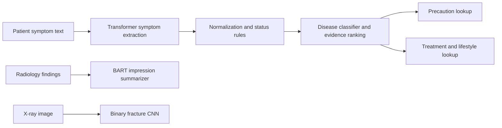

# Medi-Guide CDSS

Medi-Guide is an academic clinical decision-support prototype that brings together symptom-based disease ranking, reference recommendations, radiology findings summarization, and binary bone-fracture image classification in a Streamlit application. It is intended for research and demonstration only. It is not a medical device, a diagnostic service, or a substitute for a licensed clinician.

## What the system does

- **Symptom-based disease prediction:** A biomedical transformer extracts symptom mentions from free text. A normalization layer maps mentions to the classifier's symptom vocabulary and uses local rules to classify symptoms as present, absent, or uncertain. A saved TensorFlow/Keras classifier predicts disease scores; the application combines model output with symptom coverage, specificity, and explicit contradiction evidence to rank candidates. These are ranking scores, not calibrated clinical probabilities.
- **Reference information:** Selecting a candidate retrieves associated precautions, medication entries, and lifestyle/workout suggestions from local data files. This is a lookup, not a personalized treatment recommendation.
- **Radiology summarization:** A fine-tuned BART model generates an impression from a radiology **findings** section. The model is not configured as a general-purpose medical-history summarizer.
- **Bone fracture detection:** A five-stage PyTorch CNN classifies an uploaded X-ray as `fractured` or `not fractured`. It does not identify fracture location or type. Its score is not a calibrated probability.



## Run the application

The commands below are for PowerShell from the repository root. Use Python 3.10 or newer and select the same environment as the Jupyter kernel. The checked-in requirements pin a CUDA-enabled PyTorch build; install a PyTorch build compatible with your machine if that pin cannot be installed. CPU inference may work for supported modules but can be slow; fracture training requires CUDA.

```powershell
python -m venv .venv
.\.venv\Scripts\Activate.ps1
python -m pip install --upgrade pip
python -m pip install -r requirements.txt
python -m streamlit run app.py
```

`requirements.txt` includes application, notebook, and training dependencies, including Streamlit, sentence-transformers, datasets, evaluate, and Accelerate. The first semantic symptom-normalization request may need to download `sentence-transformers/all-MiniLM-L6-v2`; allow network access on first use or pre-cache that model. The trained NER and BART checkpoints are loaded locally.

## Repository map

```text
app.py                                  Streamlit interface
src/
  bone_fracture_detection/              CNN, preprocessing, inference, configuration
  disease_prediction/                   Disease classifier inference and normalization
    ner/                                 Symptom NER extraction, data preparation, training
  recommendations/                      Precaution and treatment-data lookups
  summarization/                        BART configuration and inference
  common/                                Shared project paths
training/
  bone_fracture_detection/               Fracture CNN training pipeline
  summarization/                         Dataset preprocessing, training, evaluation utilities
data/                                    Datasets and recommendation source tables
models/                                  Local checkpoints and derived model metadata
results/                                 Evaluation notebooks, metrics, figures, and tables
```

Model weights and the large fracture image tree are excluded from Git by `.gitignore`; no download/bootstrap script or hosted checkpoint URLs are provided in this repository. A fresh clone is therefore **not runnable until those local assets are supplied** at the paths in the table below. Do not expect `pip install -r requirements.txt` alone to supply weights or datasets. Paths resolve relative to the repository; see `src/summarization/config.py`, `src/bone_fracture_detection/config.py`, and `src/common/paths.py`.

## Data and model assets

| Component | Data | Local model/artifacts |
|---|---|---|
| Disease prediction | `data/disease_prediction/Training.csv`, `Testing.csv` | `models/disease_prediction/disease_model.keras`, `metadata.json` |
| Symptom NER | `data/ner/` and `data/ner/splits/` | `models/ner/symptom_ner_model/` |
| Recommendations | `data/recommendations/` | `models/recommendations/treatment_data.json` |
| Radiology summarization | `data/summarization/processed/{train,validation,test}.csv` | `models/summarization/checkpoint-68658/` |
| Fracture classification | `data/xray-fracture/Bone_Fracture_Binary_Classification/{train,val,test}/{fractured,not fractured}/` | `models/bone_fracture_detection/fracture_cnn.keras` |

The summarization CSVs should contain `findings` and `impression`; optional columns such as `background`, `subject_id`, and `study_id` may be present. Current inference uses findings only. The configured summarization source is `tgrex6/mimic-cxr-reports-summarization`; dataset access and use must follow its terms.

The fracture dataset's `README.dataset.txt` attributes the images to the Fractured X-ray Images dataset and specifies ODC-By v1.0. Retain attribution and comply with the dataset license when redistributing or publishing derived work.

## Training and data preparation

Training is not required to launch the app when compatible trained artifacts are already present. These commands modify or create datasets/checkpoints; back up artifacts before intentionally running them.

```powershell
# Disease classifier; writes the saved classifier and its metadata
python -m src.disease_prediction.train_model

# Prepare the NER BIO train/validation/test files, then fine-tune the token classifier
python -m src.disease_prediction.ner.ner_data
python -m src.disease_prediction.ner.ner_train

# Prepare summarization splits, then fine-tune BART
python -m training.summarization.preprocess
python -m training.summarization.train

# Train the fracture CNN (CUDA required; writes the configured checkpoint)
python -m training.bone_fracture_detection.train_model
```

Disease training removes the all-null `Unnamed: 133` column and deduplicates symptom profiles for its internal training/validation process. Fracture training expects the folder structure above, uses validation data to select its operating threshold, and writes unreadable image paths to `models/bone_fracture_detection/skipped_images.txt`. Do not use the final test split to tune models or thresholds.

## Evaluation and current results

The numbered evaluation notebooks are designed to run in order. They record dependencies, limitations, and outputs; metrics, plots, and tables are saved under `results/metrics/`, `results/figures/`, and `results/tables/`.

1. `01_project_overview_and_data_audit.ipynb`
2. `02_radiology_summarization_evaluation.ipynb`
3. `03_bone_fracture_cnn_evaluation.ipynb`
4. `04_symptom_ner_evaluation.ipynb`
5. `05_symptom_normalization_evaluation.ipynb`
6. `06_disease_prediction_evaluation.ipynb`
7. `07_end_to_end_pipeline_and_ablation_study.ipynb`
8. `08_robustness_uncertainty_and_error_analysis.ipynb`
9. `09_unified_results_dashboard.ipynb`
10. `10_summarization_pretrained_vs_finetuned_comparison.ipynb`
11. `11_fracture_cnn_untrained_vs_trained_comparison.ipynb`

Run with JupyterLab from the repository root:

```powershell
python -m pip install jupyterlab nbformat seaborn rouge-score
python -m jupyter lab results
```

The most recent saved experiment files report:

- **Summarization:** on a seeded sample of 100 unique valid pairs from the 2,000-row test CSV, ROUGE-1 = 0.588, ROUGE-2 = 0.457, and ROUGE-L = 0.546. The pretrained baseline and clinician review were not run. ROUGE is lexical similarity, not clinical correctness.
- **Fracture CNN:** 500 readable test images were evaluated; six images were unreadable. Accuracy = 0.976, fracture sensitivity = 0.971, specificity = 0.981, and fracture F1 = 0.975.
- **Disease classifier:** accuracy and macro-F1 = 1.00 on 42 test examples. This score is not an independent validation result: 41 of the 42 exact symptom profiles also occur in the training data, and the test data has one example per disease.
- **Symptom NER:** token accuracy = 0.935 and strict span F1 = 0.572 on 116 annotated test sentences.
- **Normalization:** the pipeline matched all 150 annotated mention instances in a coverage check; canonical correctness was not measured. Output stability under controlled perturbations ranged from 0.646 for last-character truncation to 1.00 for uppercase and whitespace changes.

No metric here establishes clinical reliability or external validation. Read detailed metrics and their run metadata under `results/metrics/`; charts and tables are stored under `results/figures/` and `results/tables/`.

## Safety and privacy

This is an academic prototype. Disease rankings, generated impressions, image classifications, precautions, medication entries, and other outputs can be incomplete or wrong. Do not use them to diagnose, rule out disease, choose treatment, or delay urgent care. Seek qualified medical assessment. Avoid entering or uploading identifying patient information; review local privacy, security, and data-governance requirements before any use with real patient data.
